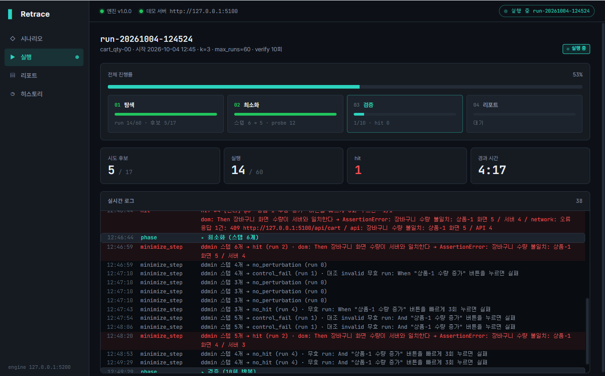
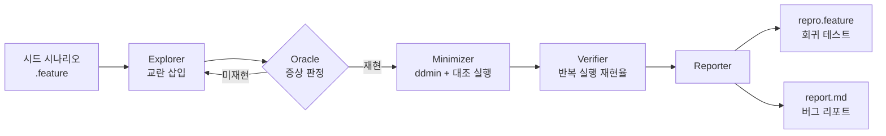
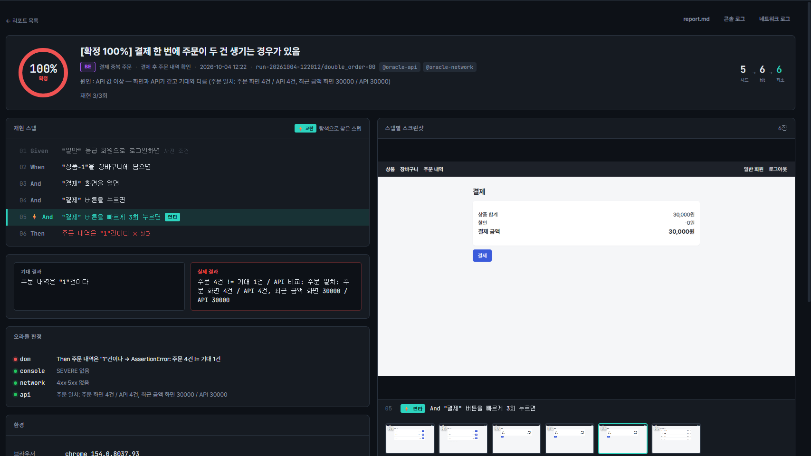

# 🔍 Retrace

> 증상만 알려진 간헐 결함의 **최소 재현 스텝을 자동으로 찾아내는** 웹 QA 도구
> 찾아낸 재현 스텝은 그대로 실행 가능한 BDD 회귀 테스트가 됩니다

[](https://github.com/Woogie-Gim/retrace/actions/workflows/ci.yml)

**빠른 실행 (Docker)**

```bash
docker compose up -d --wait
docker compose run --rm --no-deps engine sh /app/docker/pipeline.sh features/seeds/double_order.feature
# 결과 : reports/pipeline-<시각>/report-*/double_order-00/report.md
```

**측정 조건**

| 항목 | 조건 |
|---|---|
| 아래 검증 결과 표 | 로컬 Windows + Chrome, 재현율은 최소 재현 시나리오 생성 시점 기록값 (반복 횟수 기록 없음) |
| 회귀 게이트 (로컬 컨테이너) | Linux 컨테이너 (python:3.13-slim + Chromium 156 headless)에서 CI 회귀 job을 3회 연속 재현해 게이트 3종 모두 통과 |
| 회귀 게이트 (GitHub Actions) | ubuntu-24.04 러너 + Google Chrome 156.0.8078.47, 같은 커밋으로 5회 실행 (push 1 + 수동 4) 게이트 3종 5/5 통과, job 소요 4분 7초 ~ 4분 38초 |
| 도커 스모크 | 중복 주문 시드로 탐색 → 최소화 → 검증 3회 → 리포트. 로컬 3회 + GitHub Actions 5회 모두 확정 100% (3/3) · BE, Actions job 소요 2분 44초 ~ 2분 55초 (Chromium 156.0.8078.73) |
| 확률 결함 재현율 (로컬 컨테이너, 10회 × 3번) | 쿠폰 30% · 60% · 60% / 수량 30% · 50% · 70% |
| 확률 결함 재현율 (GitHub Actions, 10회 × 5번) | 쿠폰 30% · 40% · 50% · 50% · 70% (합계 23/50) / 수량 50% · 60% · 60% · 40% · 50% (합계 26/50) |

**한계** : 확률 결함 재현율은 10회 표본이라 실행마다 크게 흔들립니다. Docker 이미지는 엔진과 데모 쇼핑몰만 담고 있어 Electron 대시보드는 포함하지 않습니다.



---

## 왜 만들었나

"가끔 결제 금액이 이상하게 찍힌다" 같은 제보는 재현 스텝이 없으면 개발팀에 넘기기 어렵습니다.
QA 엔지니어가 뒤로가기·연타·느린 네트워크 같은 조건을 하나씩 바꿔가며 재현을 시도하는 시간은 길고 반복적입니다.

Retrace는 이 과정을 자동화합니다.

1. 이슈 직전까지 아는 대략적 스텝(시드 시나리오)을 입력
2. 스텝 사이에 교란 액션을 끼워 넣으며 증상 재현 탐색
3. 재현된 시퀀스에서 군더더기 스텝을 걷어내 최소 재현 스텝 도출
4. 반복 실행으로 재현율 측정 + UI·API 교차 검증으로 원인 계층 분류

핵심은 스텝을 줄이는 것이 아니라 **시드에 빠져 있던 결정적 스텝을 찾아내는 것**입니다.

---

## 핵심 기능

| 기능 | 설명 |
|---|---|
| 교란 탐색 | 연타 / 뒤로가기 / 새로고침 / 네트워크 지연 / 창 크기 / 경계값 입력 |
| 다중 오라클 | 화면 검증 + 콘솔 에러 + HTTP 상태 + API 데이터 대조 |
| 최소화 | Delta Debugging(ddmin) + 대조 실행 가드로 hit 시퀀스 축소 |
| 재현율 측정 | 무효 실행 제외 반복 실행 → `확정` / `간헐` / `희귀` / `미재현` / `판정불가` |
| 원인 계층 분류 | 화면 값과 API 값 대조로 FE / BE 결함 자동 구분 |
| BDD 출력 | 최소 재현 스텝을 `.feature`로 출력 → pytest-bdd 회귀 테스트로 즉시 실행 |
| 대시보드 | 실시간 탐색 로그 / 스텝 타임라인 / 스크린샷 / 재현율 게이지 / 히스토리 |

---

## 동작 흐름



---

## 예시 : 장바구니 수량 불일치

**입력 : 시드 시나리오**

```gherkin
@oracle-api @oracle-network
Feature: 장바구니 수량 불일치
  증상: 장바구니 화면 수량과 실제 주문 수량이 다른 경우가 있음

  Background:
    Given "일반" 등급 회원으로 로그인하면

  Scenario: 장바구니 수량 증가
    When "상품-1"을 장바구니에 담으면
    And "장바구니" 화면을 열면
    And "상품-1 수량 증가" 버튼을 누르면
    Then 장바구니 화면 수량이 서버와 일치한다
```

평범한 흐름이라 버그 모드에서도 이 시나리오는 **통과**합니다.

**출력 : 최소 재현 시나리오**

```gherkin
  Background:
    Given "일반" 등급 회원으로 로그인하면

  Scenario: 장바구니 수량 증가 (최소 재현)
    When "상품-1"을 장바구니에 담으면
    And "장바구니" 화면을 열면
    And "상품-1 수량 증가" 버튼을 누르면
    And "상품-1 수량 증가" 버튼을 빠르게 3회 누르면   # 탐색으로 찾은 교란
    Then 장바구니 화면 수량이 서버와 일치한다
```

**리포트 판정**

- 재현율 : 간헐 90% (이 리포트의 생성 시점 측정값, CI 5회 합계는 52% · 아래 검증 결과 ¹ 참고)
- 원인 계층 : FE (API 정상 + 화면 값 불일치 / 화면 5 · API 4)
- 근거 : dom·network(409 응답)·api 오라클 3종 동시 hit



---

## 검증 결과

데모 쇼핑몰에 심어둔 결함 4종 기준

| 결함 | 찾아낸 교란 | 시드 → hit → 최소 | 첫 재현까지 실행 | 재현율 | 원인 계층 |
|---|---|---|---|---|---|
| 결제 연타 중복 주문 | 결제 버튼 연타 | 5 → 6 → 6 | 2회 | 확정 100% | BE |
| 쿠폰 할인 이중 적용 | 뒤로가기 후 쿠폰 재적용 | 5 → 7 → 6 | 9회 | 간헐 46% ¹ | BE |
| 저속 네트워크 빈 화면 | 네트워크 slow-3g | 3 → 4 → 4 | network 우선 재탐색 | 확정 100% | FE |
| 장바구니 수량 불일치 | 수량 버튼 연타 | 5 → 6 → 6 | 14회 | 간헐 52% ¹ | FE |

- 스텝 수는 Background와 Then을 포함한 값입니다
- 최소 스텝이 시드보다 긴 것이 정상입니다. 시드에 없던 교란 스텝이 결함의 원인이기 때문입니다
- ¹ 확률 결함입니다. 재현율은 GitHub Actions 5회 실행(각 10회 verify) 합계입니다 : 쿠폰 23/50 = 46% (회차별 30~70%), 수량 26/50 = 52% (회차별 40~60%). 최소 재현 시나리오 생성 시점의 단일 측정값은 쿠폰 30% · 수량 90%였으며, 10회 표본은 실행마다 크게 흔들려 합계 값을 기준으로 삼습니다. 결함이 켜져 있어도 개별 실행은 통과할 수 있습니다

### 회귀 테스트 동작

| | BUG_MODE=on | BUG_MODE=off |
|---|---|---|
| 원래 시드 시나리오 4건 | ✅ 4 passed | ✅ 4 passed |
| 생성된 최소 재현 시나리오 4건 | ❌ 4 failed ² | ✅ 4 passed |

² 확정 결함 2건(중복 주문 · 빈 화면)은 항상 실패합니다. 확률 결함 2건(쿠폰 46% · 수량 52%, ¹ 참고)은 실행에 따라 통과할 수 있어 실패 건수가 2~4건 사이에서 달라집니다

평범한 시드로는 버그가 드러나지 않고 Retrace가 찾아낸 시나리오만 결함을 잡아냅니다.
결함이 수정되면(`off`) 같은 시나리오가 통과하므로 그대로 회귀 테스트로 쓸 수 있습니다.

---

## 개발 과정에서 검증한 것

Claude Code로 구현하고 Phase별 완료 기준을 직접 정해 각 단계 결과를 수동 확인·API 대조·보안 점검으로 독립 검증했습니다.

**사람 손으로는 안 잡히는 결함**
결제 버튼 수동 연타로는 중복 주문이 재현되지 않았지만 브라우저 콘솔로 연속 클릭하자 주문 3건이 생성됐습니다. 처리 지연 구간 안에 두 번째 클릭이 들어가야 하는 결함이라 자동화가 필요한 이유를 그대로 보여준 사례입니다.

**탐색 hit를 그대로 믿지 않기**
빈 화면 결함이 탐색 단계에서 "뒤로가기"로 한 번 잡혔지만 Verifier 반복 실행에서 13회 연속 미재현이었습니다. 판정 스텝이 목록 렌더링 전에 확인한 타이밍 오탐으로 판단해 명시적 대기를 적용하고 network 교란 우선으로 재탐색해 확정 100%를 얻었습니다.

**타이밍 여유 확보**
저속 네트워크 응답이 FE 제한 2,000ms를 약 30ms만 넘겨 PC 부하에 따라 결과가 흔들릴 수 있었습니다. 교란 프로필 지연을 조정해 약 1초 여유를 확보했습니다.

**가짜 축소 차단**
ddmin이 결제 스텝 자체를 지워 "주문 0건 ≠ 기대 1건"으로 실패하는 경우도 hit로 착각할 수 있습니다. 결함 없는 대조 실행과 비교해 같은 이유로 실패할 때만 축소를 채택하도록 막았습니다.

**배포 환경 점검**
리포트 파일 제공 엔드포인트에 경로 조작(Path Traversal) 요청을 보내 `.env` 노출이 없는지 확인했습니다. 설치 폴더 쓰기 권한 문제를 피하려 리포트를 `%APPDATA%`에 저장하고 앱 종료 시 엔진·크롬 프로세스 잔존이 없는지 점검했습니다.

---

## 기술 스택

| 영역 | 스택 |
|---|---|
| 엔진 | Python 3.13 / Selenium 4 / gherkin-official / parse |
| 테스트 | pytest / pytest-bdd |
| API 검증 | requests |
| 엔진 서버 | FastAPI / WebSocket / uvicorn |
| 데모 타깃 | FastAPI + Vanilla HTML/JS |
| 프론트엔드 | Electron |
| 빌드 | PyInstaller / electron-builder |

---

## 설치 및 실행

### 릴리스 버전

[Releases](https://github.com/Woogie-Gim/retrace/releases)에서 설치본 또는 zip 다운로드

- 요구 사항 : Windows 10/11 x64 + Chrome 브라우저
- 드라이버 : 첫 실행 시 자동 확보 (인터넷 연결 필요)
- 데모 쇼핑몰 : 앱 실행 시 자동 기동
- 리포트 저장 위치 : `%APPDATA%\Retrace\reports`
- 코드 서명이 없어 SmartScreen 경고가 뜰 수 있습니다 → "추가 정보" → "실행"

### 개발 환경

```bash
git clone https://github.com/Woogie-Gim/retrace.git
cd retrace

python -m venv engine/.venv
source engine/.venv/Scripts/activate
pip install -r engine/requirements.txt   # 설치본 빌드 시 engine/requirements-build.txt
cp .env.example .env
```

터미널 3개에서 각각 실행합니다.

```bash
# 1. 데모 쇼핑몰 (http://127.0.0.1:5100)
cd demo-shop
BUG_MODE=on ../engine/.venv/Scripts/python -m uvicorn demo_shop.app:app --port 5100

# 2. 엔진 서버 (http://127.0.0.1:5200)
cd engine
.venv/Scripts/python -m retrace.server

# 3. 대시보드
cd app
npm install
npm run dev
```

### 회귀 테스트

데모 쇼핑몰을 띄운 상태에서 실행합니다.

```bash
engine/.venv/Scripts/python -m pytest engine/tests -v
```

`BUG_MODE=on`에서는 `test_generated.py`의 최소 재현 시나리오 4건이 **실패하는 것이 정상**입니다. 결함이 재현된다는 뜻입니다. `BUG_MODE=off`로 띄우면 전부 통과합니다.

### CI 게이트 기준

CI는 결과가 실행마다 같아야 하는 항목만 필수 게이트로 둡니다. 필수 게이트는 세 가지입니다.

1. `off`에서 전체 테스트(시드 4건과 생성 4건 포함)가 통과합니다.
2. `on`에서 시드 4건이 통과합니다.
3. `on`에서 확정 100% 결함(중복 주문 · 빈 화면)의 생성 시나리오가 실패합니다.

쿠폰 · 수량 같은 확률 결함은 결함이 켜져 있어도 한 번의 실행에서는 통과할 수 있습니다. 그래서 게이트로 쓰면 코드 변경과 무관하게 빌드가 흔들립니다. 이 두 결함은 `retrace verify`로 10회 반복해 재현율만 측정하고 Step Summary에 정보로 표시하며, 결과는 빌드 성패에 반영하지 않습니다. `BUG_SEED`를 고정하면 결과가 재현될 수 있지만 타이밍 영향을 받는 결함이 있어 게이트로 쓰지 않습니다.

### 빌드

```bash
# 엔진·데모 쇼핑몰 (PowerShell, 빌드 전용 의존성 필요)
engine/.venv/Scripts/pip install -r engine/requirements-build.txt
scripts/build-engine.ps1

# 앱 설치본·zip
cd app
npm run dist
```

---

## 프로젝트 구조

```
retrace/
├── engine/retrace/
│   ├── driver/       # Driver 인터페이스 + SeleniumDriver (플랫폼 확장 지점)
│   ├── scenario/     # feature 파싱 + 스텝 레지스트리 + pytest-bdd 어댑터
│   ├── steps/        # 엔진·회귀 테스트 공용 스텝 정의
│   ├── explorer/     # 교란 카탈로그 + 우선순위 탐색
│   ├── oracle/       # dom / console / network / api 판정
│   ├── minimizer/    # ddmin + 대조 실행 가드
│   ├── verifier/     # 재현율 측정 + 등급 분류
│   ├── reporter/     # feature / md / json 리포트 + 원인 계층 분류
│   └── server/       # FastAPI + WebSocket 진행 스트림
├── demo-shop/        # 결함 4종을 심어둔 시연용 쇼핑몰 (BUG_MODE 토글)
├── features/
│   ├── seeds/        # 사람이 작성한 시드 시나리오
│   └── generated/    # 엔진이 만든 최소 재현 시나리오
├── app/              # Electron 대시보드
├── scripts/          # 빌드 스크립트 + CI 게이트 판정 (ci_gate.py)
├── docker/           # 컨테이너 파이프라인 스크립트
├── .github/workflows # CI (회귀 게이트 + 도커 스모크)
└── docs/             # 개발 계획서 / 릴리스 노트
```

---

## 설계 포인트

- **재현 스텝 = 회귀 테스트** : 엔진과 pytest-bdd가 같은 스텝 정의를 공유해 탐색 결과가 곧바로 실행 가능한 테스트가 됩니다
- **화면 너머 데이터 검증** : 화면과 API가 같고 기대와 다르면 BE / API는 정상인데 화면만 다르면 FE로 분류합니다
- **간헐 결함 대응** : 후보마다 반복 실행해 1회라도 재현되면 유지하고 전제 스텝 실패로 끝난 실행은 무효로 제외합니다
- **플랫폼 확장 구조** : 조작 계층을 `Driver` 인터페이스로 분리해 탐색·최소화·검증·리포트 로직을 재사용할 수 있습니다

---

## 알려진 한계

- 시연용 데모 쇼핑몰 기준으로 검증했으며 실서비스 대상 검증은 진행하지 않았습니다
- Python이 전혀 없는 PC와 크롬 미설치 PC는 근사 환경으로만 확인했습니다
- 작업 관리자 강제 종료 시 데모 쇼핑몰 프로세스가 남을 수 있습니다 (정상 종료 시 문제없음)
- Windows 전용 빌드입니다

---

## 향후 계획

- [ ] 모바일 게임 확장 : ADB 입력 + VLM 화면 판정 기반 `GameDriver`
- [ ] 게임 전용 교란 : 화면 전환 중 연타 / 백그라운드 전환 / 네트워크 단절
- [ ] LLM 보조 : 증상 설명 기반 교란 우선순위 추천
- [ ] CI 연동 : 생성 시나리오 자동 회귀 실행

---

## Author

[@Woogie-Gim](https://github.com/Woogie-Gim)